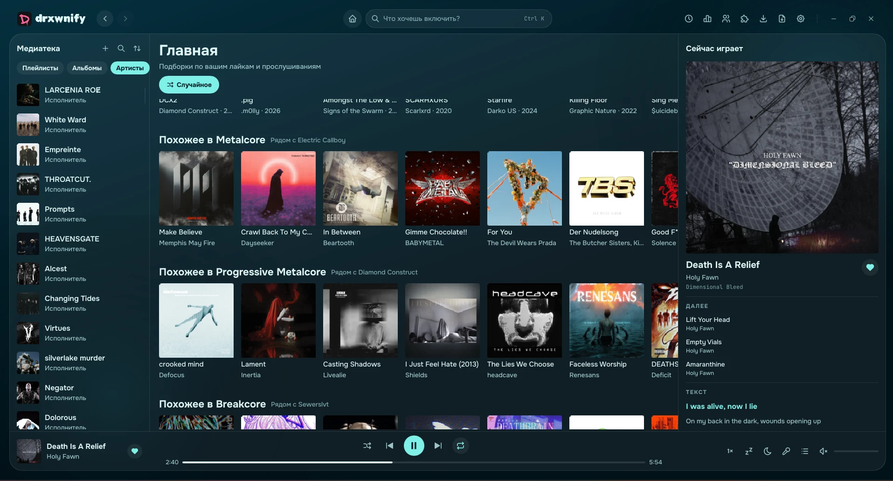
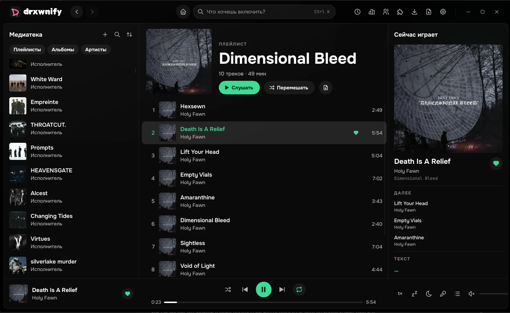

# Drxwnify для ПК

Музыкальный плеер для Windows — компьютерная версия Drxwnify для Android. Одна медиатека для Spotify, Яндекс Музыки,
ВКонтакте и YouTube Music: треки из любого каталога играют, даже если у сервиса нет своего плеера на ПК, — звук
находится по названию в доступных источниках.

## Зачем

- Слушать свои лайки и плейлисты из всех сервисов в одном окне, без браузера и без подписок на каждый.
- Перенести всё с телефона: резервная копия Drxwnify для Android открывается на ПК целиком — медиатека, история,
  настройки, аккаунты, друзья и чаты. Обратно — тоже.
- Плеер, который не мешает: Drxwnify Mini занимает около 45 МБ памяти, в простое не грузит процессор, страницы
  открываются сразу.

## Возможности

- Медиатека: лайки, плейлисты, альбомы и исполнители всех подключённых аккаунтов; сортировка, поиск, «Мой топ».
- Поиск по основному каталогу, медиатеке и другим аккаунтам; ссылки Spotify, Яндекса, YouTube открываются сразу.
- Главная: подборки по лайкам и прослушиваниям, новинки любимых исполнителей, похожее по жанрам, «Случайное»;
  новые релизы и настроения YouTube Music.
- Страницы альбомов и исполнителей с дискографией, похожими исполнителями и прослушиваниями.
- Источники звука: SoundCloud, YouTube, ВКонтакте — включаются и сортируются в настройках; найденные совпадения
  запоминаются и общие с телефоном.
- Плеер: очередь, бесконечное продолжение похожими, кроссфейд и переходы без пауз, нормализация громкости,
  эквалайзер с пресетами и профилями AutoEq, баланс, темп и тон, пропуск тишины, таймер сна, SponsorBlock.
- Синхронные тексты песен (LRCLIB, BetterLyrics, KuGou) с перемоткой по строке.
- Лайки уходят в Spotify, Яндекс и ВК; скробблинг в Last.fm; статус в Discord.
- Друзья: что слушают сейчас, история, портрет вкуса, чаты, «Слушать вместе» и комнаты.
- Загрузки для прослушивания без сети, экспорт и импорт плейлистов (CSV, M3U).
- История и статистика прослушиваний, итоги года.
- Медиаклавиши и системная панель Windows, глобальные сочетания клавиш, трей, ссылки `drxwnify://`.
- 9 тем оформления, у каждой светлый и тёмный вариант.

## Установка

Скачайте `drxwnify-mini-setup.exe` из [релизов](https://github.com/slvx666/drxwnifyRustPC/releases) и запустите.
Права администратора не нужны: программа ставится для текущего пользователя, появляется в меню «Пуск» и удаляется
через «Параметры → Приложения». Нужна Windows 10 или 11 (64 бит).

Первый запуск: импортируйте резервную копию из Drxwnify на телефоне (кнопка на пустом экране) — подтянутся
медиатека и аккаунты.

## Две редакции

- **Mini** — нативная, лёгкая (Rust + Slint, без браузерного движка). Готова, её и скачивают.
- **Full** — на Tauri, с анимациями и расширенным интерфейсом. В работе.

Обе используют одно ядро (`crates/`), интерфейсы только показывают состояние.

## Сборка

Нужны Rust (стабильный, 1.85+), Visual Studio Build Tools с C++ и CMake.

    cargo build -p drxwnify-mini --profile release-mini
    cargo build -p drxwnify-mini-setup --profile release-mini

## Лицензия

GPL-3.0-or-later.
